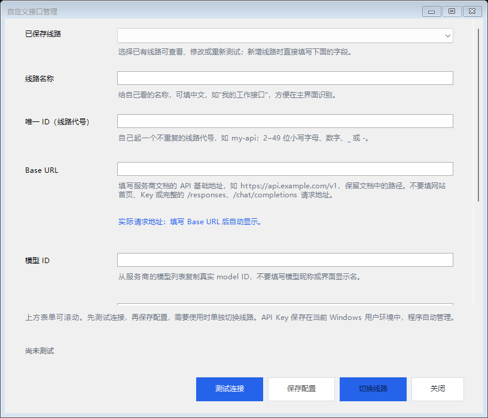
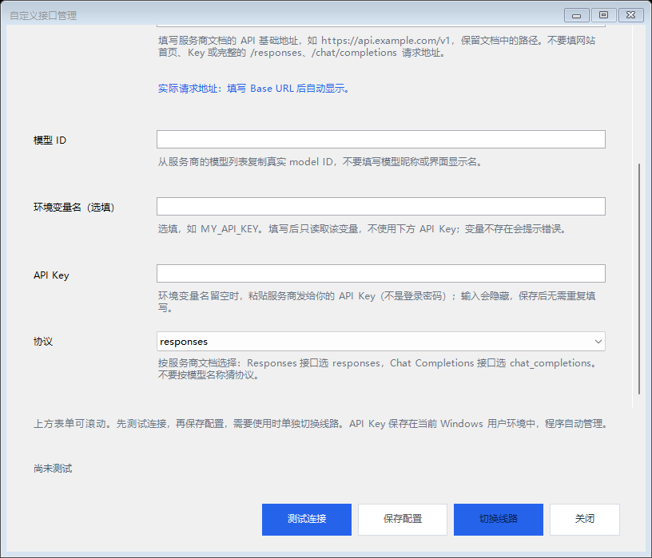
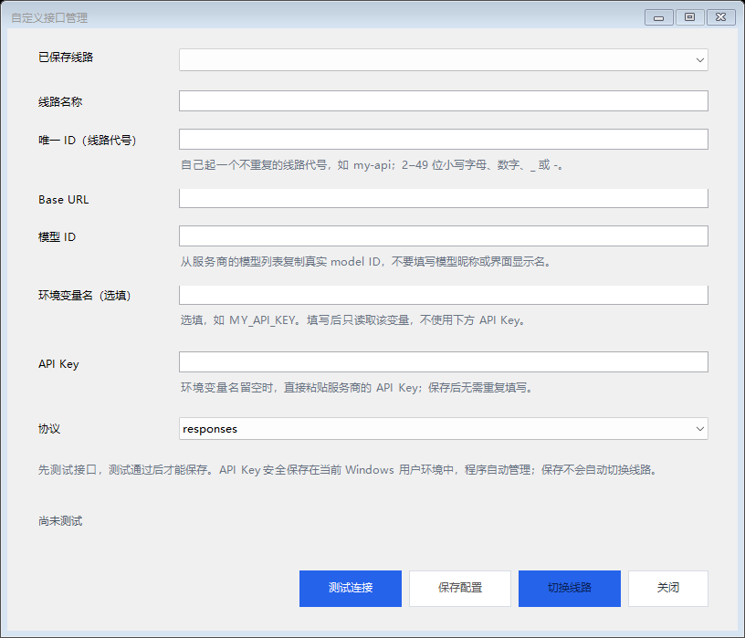
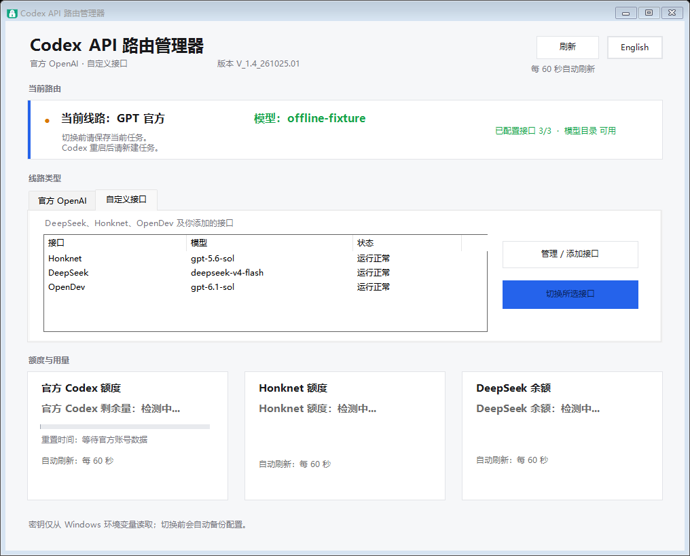
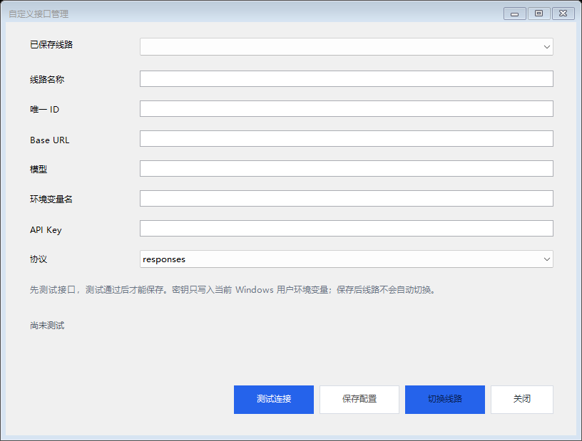
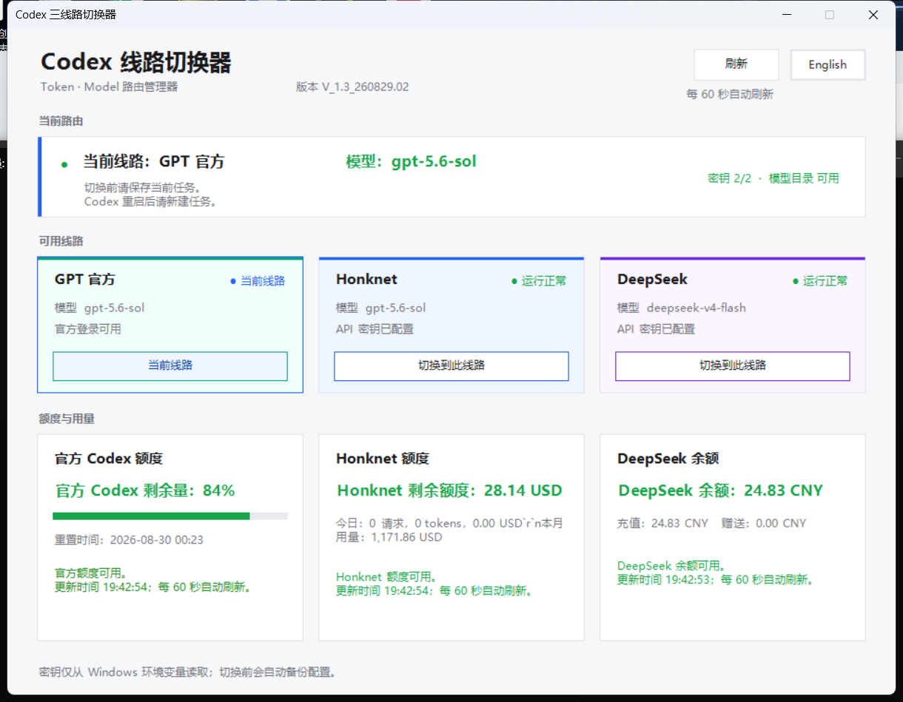
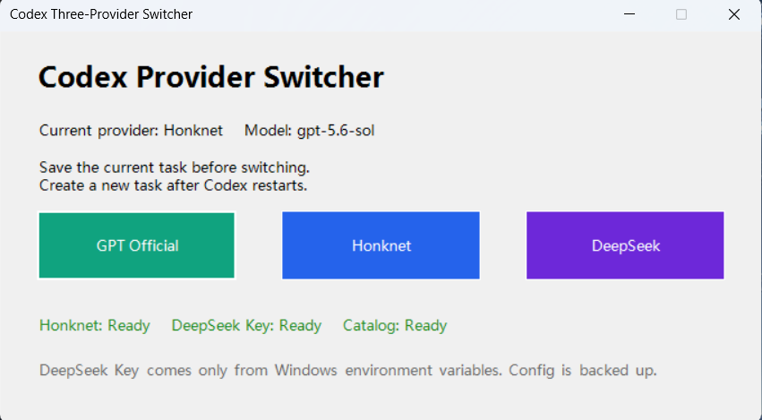

# GUI 版本对照

本页记录 Codex API 路由管理器各版本的界面变化。截图均使用脱敏示例数据，不包含真实 API Key。

## V_1.4_261026.02（Windows 当前版本，v1.4.2）





- 全部八个字段都增加填写说明；表单滚动，底部操作固定。
- Base URL 实时预览最终请求地址，提示保留服务商文档路径。
- 阻止完整端点重复拼接及在 URL 中放入凭据或查询参数。

## V_1.4_261026.01（历史版本，v1.4.1）



- 唯一 ID 增加内部代号、示例、长度及不重复说明。
- 模型改为“模型 ID”，提示从服务商模型列表复制真实 ID。
- 环境变量名选填；填写时只读取变量，不回退至 API Key，也不覆盖变量值。
- 变量名留空可直接填 Key；保存后自动管理，重开无需重复填写。
- 修改凭据或协议、再次测试失败时，保存和切换会重新禁用。

## V_1.4_261025.01（历史版本，v1.4.0）





截图来自离线 GUI 回归，额度与模型为测试占位信息。

- 正式更名为 Codex API 路由管理器，使用新版图标。
- 官方 OpenAI 与自定义接口分为两个入口；内置 Honknet、DeepSeek、OpenDev。
- 支持查看已保存线路，并将测试连接、保存配置、切换线路分开操作。
- 修改连接参数后需要重新测试；保存线路不会自动切换当前 Codex 路由。
- 安装包和便携包包含相同版本的脚本、Provider 定义与图标。
- macOS 仍提供 v1.3 历史稳定版。

## V_1.3_260829.02（历史版本）



此版本的定位从“线路切换按钮”升级为 Token · Model 路由管理器：

- 顶部展示软件版本号、当前线路、实际模型和同步状态。
- 当前实际模型使用绿色状态高亮，避免和 Provider 品牌色混淆。
- GPT Official、Honknet、DeepSeek 使用青绿、蓝、紫的浅色卡片和边框进行区分。
- 当前线路使用蓝色选中边框和“当前线路”按钮状态。
- 额度与用量拆成三张卡片，官方额度、Honknet 用量和 DeepSeek 余额一眼可比。

## v1.2.0（上一版）



上一版以纵向信息流为主，功能完整，但线路按钮占据较大的纯色区域，当前线路、模型和额度信息层级不够明显。该版本仍保留在 [GitHub Release v1.2.0](https://github.com/Frog1205/codex-three-provider-switcher/releases/tag/v1.2.0) 中，旧安装包和便携包不会被新版本替换。

## macOS Apple Silicon 版

macOS 版从 v1.3 开始同步提供独立 GUI，界面采用同一套路由卡片、Provider 配色、绿色当前模型状态和三张额度卡片。它只支持 Apple Silicon（M 系列）芯片，Intel Mac 会在启动时拒绝运行；macOS 版不复用 Windows 的 PowerShell/WinForms 额度读取器，而是用 Python 标准库并发查询官方 Codex、Honknet 和 DeepSeek，同时共享同一份 Provider 模型定义和配置备份规则。

## 版本号规则

GUI 版本号使用以下格式：

```text
V_<大版本>.<需求版本>_<YYMMDD>.<当天序号>
```

例如 `V_1.3_260829.02` 表示大版本 1、第三次需求修改、2026-08-29、当天第二次修改。GitHub Release 使用兼容平台排序的三段式版本号（本次 Windows 为 `v1.4.2`），GUI 和安装包文件名保留完整版本标识。

## 下载对应版本

- Windows 当前版本：[v1.4.2](https://github.com/Frog1205/codex-three-provider-switcher/releases/tag/v1.4.2)
- Windows 上一版本：[v1.4.1](https://github.com/Frog1205/codex-three-provider-switcher/releases/tag/v1.4.1)
- Windows 上一版本：[v1.4.0](https://github.com/Frog1205/codex-three-provider-switcher/releases/tag/v1.4.0)
- macOS 稳定版及 Windows 历史版：[v1.3.0](https://github.com/Frog1205/codex-three-provider-switcher/releases/tag/v1.3.0)
- 上一版本：[v1.2.0](https://github.com/Frog1205/codex-three-provider-switcher/releases/tag/v1.2.0)
